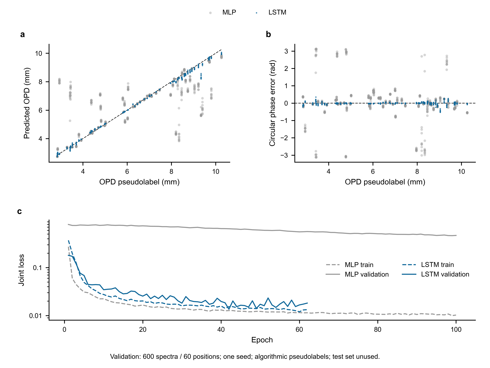

# 基于深度学习的端到端光谱干涉信号智能解调

重庆大学2024级智能感知工程专业《人工智能基础》课程设计。参考教材：Artificial Intelligence: A Modern Approach（第四版）。

研究对象：迈克尔逊干涉仪，目标为光程差（OPD）与参考波长处的相位联合估计。

为了提高预测速度，我们将 **10001 点原始光谱**直接输入 CNN 或双向 LSTM，输出**光程差（OPD）和 1560 nm 处的包裹相位**。训练沿用传统解调离线生成的伪标签。预测时直接输入原始强度，省去传统预处理与求解步骤。

## 项目演示与汇报材料

- [在线演示网页（10001 点原始光谱版）](https://kyson001.github.io/intelligent-demodulation-of-spectral-interference-signalsls/)
- [网页源码与部署说明](web/README.md)
- [最终课程汇报 PPT](presentations/汇报.pptx)
- [光谱干涉智能解调 · CNN 与 BiLSTM 历史对比报告（PDF）](<presentations/光谱干涉智能解调 · CNN 与 BiLSTM 对比报告.pdf>)

## 原始光谱联合解调

两个模型用同一按位置划分的 2800 条光谱训练、600 条验证选模，冻结后在同一份 600 条、60 个位置的测试集上比较。输入为 1510–1610 nm、步长 0.01 nm 的原始波长网格。预测入口检查网格并将记录的强度送入模型。模型图内保留轻量归一化和特征提取层。

| 方法 | 单帧 P50 / ms | 单帧 P95 / ms | OPD MAE / μm | 相位圆周 MAE / rad |
|---|---:|---:|---:|---:|
| 传统峰间距＋局部傅里叶相位 | 9.65 | 12.07 | 伪标签来源 | 伪标签来源 |
| 原始光谱 CNN | 1.31 | 1.77 | **1.103** | **0.01410** |
| 原始光谱 BiLSTM | **0.97** | **1.34** | 10.203 | 0.02721 |

时间在同一 CPU 单线程测量，由已读入内存的原始波长与强度到两个解调结果，包含各自必要的处理。CNN 和 BiLSTM 中位延迟约为传统流程的 1/7.35 和 1/9.97。误差以传统算法伪标签为参考，实际测量精度仍需独立标定。

在仓库根目录预测一条原始 CSV：

```powershell
python scripts/predict_raw_demodulation.py --model cnn datasets/raw/file0001.csv
python scripts/predict_raw_demodulation.py --model bilstm datasets/raw/file0001.csv
```

[模型框架](src/demodulation/raw_models.py) · [共用训练入口](scripts/train_raw_demodulation.py) · [模型权重、对比结果与复现步骤](results/raw_demodulation/README.md)

## 可编辑PPT、绘图代码与独立工程

- [用户修改后的可编辑网络结构图PPT](presentations/LSTM网络结构图_可编辑版.pptx)：按桌面原文件保存，文字、图形和连线可分别编辑。
- [全部绘图入口与代码索引](docs/11_绘图与独立工程代码索引.md)：原始/处理后光谱、包络和Hann窗、FFT/相位、MLP/LSTM对比及三版网络结构图。
- [独立LSTM教学工程](examples/lstm_standalone/)：`model.py`、中文注释`train.py`、依赖及运行说明。
- [独立预处理代码](examples/preprocessing_c/)和[三套历史结构图](results/lstm_architecture/)。

绘图默认读取仓库内的`datasets/`，无需此前电脑上的桌面路径。三种预处理配置的批量比较入口为`scripts/compare_preprocessing_dataset.py`，`scripts/compare_preprocessing.py`保留用户修改后的单谱绘图用途。

## 数据、代码与整个课题的复现思路

- [处理前数据](datasets/raw)：4000个原始CSV。
- [处理后数据](datasets/processed)：`train.npz`、`validation.npz`、`test.npz`，分别2800、600、600条。
- [数据格式与读取方法](datasets/README.md)：NPZ字段、伪标签和质量掩码。
- [中文注释预处理代码](scripts/preprocess_c.py)。
- [整个课题的复现思路与操作步骤](docs/08_整个课题复现思路与操作步骤.md)：数据链路、后续网络训练、评价、网页及PPT的实施安排。

原始CSV及处理后数组均已放在仓库内；下载后可直接使用，也可从原始数据重新计算。

## 历史实验：2048 点 LSTM 与 MLP

完整中文讲解见[LSTM手把手教程](docs/10_LSTM联合解调手把手教程与MLP对比.md)，代码为[网络定义](src/demodulation/joint_lstm.py)和[训练入口](scripts/train_joint_lstm.py)。输入按波数轴组织成256个连续8点块，没有卷积、抽点或重复谱拼接。

| 模型，单种子验证集600条 | OPD MAE / μm | 相位圆周MAE / rad |
|---|---:|---:|
| 原MLP | 887.691 | 0.638882 |
| 双向LSTM，仅终态读出对照 | 1829.367 | 1.4338 |
| 双向LSTM，全局＋参考点读出 | 95.936 | 0.051840 |

主LSTM相对MLP的OPD/相位MAE分别下降89.19%/91.89%。改善包含序列建模与读出结构的作用，不能归结为“换LSTM必然更好”。数据哈希、种子、优化器、损失和训练上限一致；实际参数量/时间不同。真实测试集未评价。

```powershell
.\.venv-training\Scripts\python.exe -X utf8 scripts/train_joint_lstm.py train --epochs 100 --device cpu --out analysis/my_lstm_100
.\.venv-training\Scripts\python.exe -X utf8 scripts/compare_joint_models.py --mlp-run results/lstm_comparison/runs/mlp --lstm-run results/lstm_comparison/runs/lstm_center_global --control-run results/lstm_comparison/runs/lstm_last
```

比较脚本直接读取已归档的权重、日志和预测；[结果目录](results/lstm_comparison)含完整指标、逐条/逐位置对比和可编辑图形。



## 历史教程：2048 点联合解调

详见[手把手教程](docs/09_不用CNN的联合解调网络手把手教程.md)。[网络、数据和损失](src/demodulation/joint_mlp.py)与[训练入口](scripts/train_joint_mlp.py)均有分块中文注释。

模型为2048→256→128→64的共享全连接层，分别输出标准化OPD和相位sin/cos。仅用训练集拟合OPD标准化，两个任务分别使用有效标签掩码，默认训练不读取测试集。

```powershell
python -m venv .venv-training
.\.venv-training\Scripts\python.exe -m pip install torch==2.15.0 --index-url https://download.pytorch.org/whl/cpu
.\.venv-training\Scripts\python.exe -m pip install -r requirements-training.txt
.\.venv-training\Scripts\python.exe -X utf8 scripts/train_joint_mlp.py train --epochs 100 --device cpu --out analysis/my_mlp_100
```

本次100轮教学实验的验证OPD MAE为887.691 μm、相位圆周MAE为0.6389 rad，最佳第99轮。完整配置和逐条结果保存在本机`analysis/joint_mlp_tutorial_seed20261117/`；教程记录了结果和限制，真实测试集尚未评价。论文前仍需改进泛化、多种子及独立真值验证。

## 传统预处理与伪标签

传统解调先做等波数插值、背景扣除、包络补偿和 Hann 加窗，再从高分辨率光谱估计光程差与相位伪标签。历史 2048 点模型还使用抗混叠降采样和逐谱 RMS 归一化。步骤和参数见[预处理说明](docs/05_预处理完整代码与分块讲解.md)与[三种配置的比较报告](docs/04_三种预处理方案实验报告.md)。


## 复现

当前验证环境为Python 3.13.5。在仓库根目录执行：

```powershell
python -m pip install -r requirements-repro.txt
python -m pytest tests -q
python -X utf8 scripts/verify_repository_data.py
python -X utf8 scripts/reproduce_data_pipeline.py
```

重算结果放入新的`analysis/reproduction/`，不覆盖已发布数据。已存在该目录时，用`--out analysis/reproduction_run2`指定新目录。各步骤及参数见[完整复现说明](docs/08_整个课题复现思路与操作步骤.md)。

CSV列为波长和强度，首行为标题。当前配置针对1510–1610 nm、10001点以及约2.3–10.3 mm的诊断OPD范围，不能直接作为其他仪器的通用标定。

预处理结果默认保存到`analysis/preprocessed_C/`，预处理/制标签阶段不自动划分。新增顺序核查强烈支持从file0001起每位置连续10条；`scripts/split_dataset_by_position.py`按位置生成2800/600/600条训练、验证和测试数据，跨位置完全重复谱绑定分区。桌面包包含原始 CSV、预处理光谱、伪标签、分组清单和完整代码，详见[位置划分与交付说明](docs/07_按采集位置分组与数据包说明.md)。

```powershell
python -X utf8 scripts/split_dataset_by_position.py
python -X utf8 scripts/verify_dataset_package.py "桌面数据包路径" --verify-raw-hashes
```

已实现多干涉峰频率间距OPD伪标签和1560 nm中心相位伪标签。全部4000条已计算，3999条OPD和3992条相位通过当前QC，8条保留待复核。中心相位使用正侧带局部二次拟合，另有峰位截距相位用于交叉检查。详见[伪标签算法与相位说明](docs/06_光程差与相位伪标签生成说明.md)。

伪标签及合并后的预处理输入在重算过程中保存在分析目录，合并前检查sample_id、原始文件哈希和预处理配置。仓库`datasets/`内提供可直接使用的原始数据、分区数组和标签清单；历史距离缓存未作为真值发布，新增算法标签也不是独立测量真值。

## 目录

- `src/demodulation/`：预处理、FFT与相位诊断估计器。
- `datasets/`：处理前CSV、处理后三份NPZ、分组清单与文件哈希。
- `scripts/`：数据审计、配对比较、绘图及模型输入导出。
- `configs/`：比较和训练输入配置。
- `tests/`：已知OPD、相位边界、采样与归一化测试。
- `results/preprocessing/`：汇总、逐样本结果和可编辑图表。
- `docs/`：材料分析、方案、预处理协议及实验报告。

## 历史实验：2048 点 CNN

新增独立 [cnn/ 成果目录与阅读导航](cnn/README.md)：包含单文件 PyTorch 程序、初版和第二版权重、神经网络图、逐步说明，以及第二版优化与鲁棒性评价结果。数据沿用本仓库 datasets/，不与其他模型目录混用。
