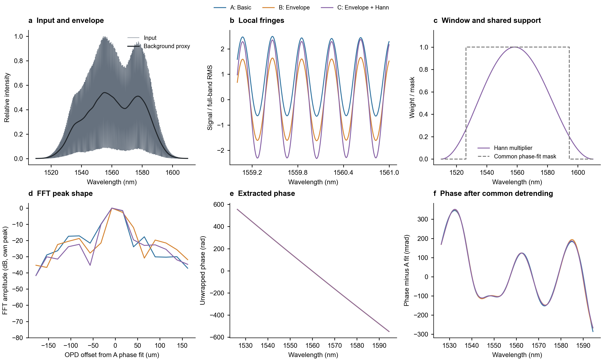

# 基于深度学习的端到端光谱干涉信号智能解调

重庆大学2024级智能感知工程专业《人工智能基础》课程设计。参考教材：Artificial Intelligence: A Modern Approach（第四版）。

研究对象：迈克尔逊干涉仪，目标为光程差（OPD）与参考波长处的相位联合估计。

当前已完成三种预处理的数值实现、全数据配对诊断、已知真值仿真控制和图表输出；尚未训练神经网络。没有独立真值的指标不表述为测量精度。

## 数据、代码与整个课题的复现思路

- [处理前数据](datasets/raw)：4000个原始CSV。
- [处理后数据](datasets/processed)：`train.npz`、`validation.npz`、`test.npz`，分别2800、600、600条。
- [数据格式与读取方法](datasets/README.md)：NPZ字段、伪标签和质量掩码。
- [中文注释C方案预处理代码](scripts/preprocess_c.py)。
- [整个课题的复现思路与操作步骤](docs/08_整个课题复现思路与操作步骤.md)：数据链路、后续网络训练、评价、网页及PPT的实施安排。

原始CSV及处理后数组均已放在仓库内；下载后可直接使用，也可从原始数据重新计算。

## 预处理比较

- A：等波数线性插值＋去常量背景。
- B：慢变背景扣除＋有下限的包络代理归一化。
- C：B＋Hann加窗。

当前按用户选择使用**C方案：包络补偿＋Hann窗**，再抗混叠至2048点并逐谱RMS归一化。完整中文注释脚本为[scripts/preprocess_c.py](scripts/preprocess_c.py)，分块讲解见[C方案使用说明](docs/05_C方案完整代码与分块讲解.md)。此前A/B/C比较结果保留于[实验报告](docs/04_三种预处理方案实验报告.md)，不将用户选择表述为已证明的精度最优。



## 复现

当前验证环境为Python 3.13.5。在仓库根目录执行：

```powershell
python -m pip install -r requirements-repro.txt
python -m pytest tests -q
python -X utf8 scripts/verify_repository_data.py
python -X utf8 scripts/reproduce_data_pipeline.py
```

重算结果放入新的`analysis/reproduction/`，不覆盖已发布数据。已存在该目录时，用`--out analysis/reproduction_run2`指定新目录。各步骤及参数见[完整复现说明](docs/08_整个课题复现思路与操作步骤.md)。

CSV列为波长和强度，首行为标题。当前配置针对1510–1610 nm、10001点以及约2.3–10.3 mm的诊断OPD范围，不能直接作为其他仪器的通用标定。

C方案结果默认保存到`analysis/preprocessed_C/`，预处理/制标签阶段不自动划分。新增顺序核查强烈支持从file0001起每位置连续10条；`scripts/split_dataset_by_position.py`按位置生成2800/600/600条训练、验证和测试数据，跨位置完全重复谱绑定分区。桌面包包含原始CSV、C输入、伪标签、分组清单和完整代码，详见[位置划分与交付说明](docs/07_按采集位置分组与数据包说明.md)。

```powershell
python -X utf8 scripts/split_dataset_by_position.py
python -X utf8 scripts/verify_dataset_package.py "桌面数据包路径" --verify-raw-hashes
```

已实现多干涉峰频率间距OPD伪标签和1560 nm中心相位伪标签。全部4000条已计算，3999条OPD和3992条相位通过当前QC，8条保留待复核。中心相位使用正侧带局部二次拟合，另有峰位截距相位用于交叉检查。详见[伪标签算法与相位说明](docs/06_光程差与相位伪标签生成说明.md)。

伪标签及合并后的C输入在重算过程中保存在分析目录，合并前检查sample_id、原始文件哈希和预处理配置。仓库`datasets/`内提供可直接使用的原始数据、分区数组和标签清单；历史距离缓存未作为真值发布，新增算法标签也不是独立测量真值。

## 目录

- `src/demodulation/`：预处理、FFT与相位诊断估计器。
- `datasets/`：处理前CSV、处理后三份NPZ、分组清单与文件哈希。
- `scripts/`：数据审计、配对比较、绘图及模型输入导出。
- `configs/`：比较和训练输入配置。
- `tests/`：已知OPD、相位边界、采样与归一化测试。
- `results/preprocessing/`：汇总、逐样本结果和可编辑图表。
- `docs/`：材料分析、方案、预处理协议及实验报告。

后续展示目标为PPT、网页、文档、代码及可复现结果。
