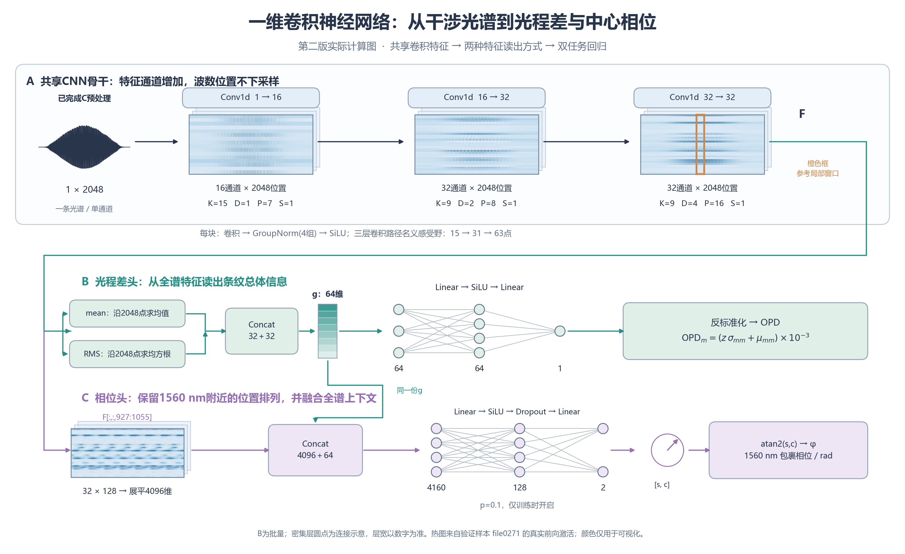
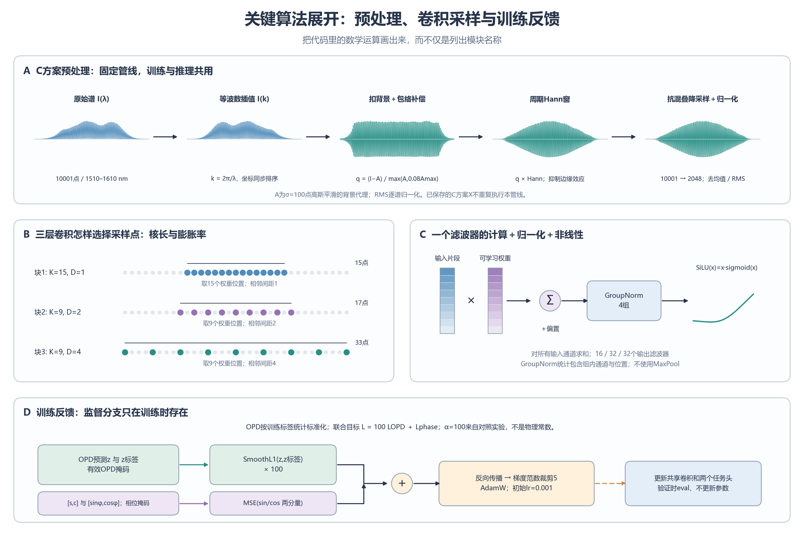
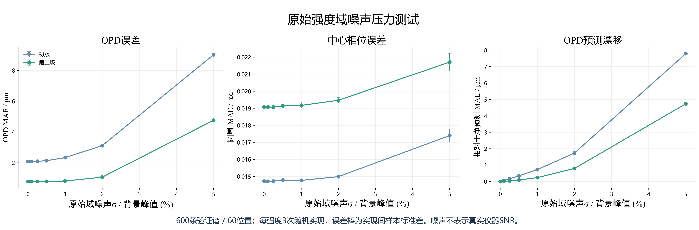

# 从一条光谱到光程差和相位：第二版CNN逐步说明

## 1. 这次交付到底是什么

这是一套基于迈克尔逊干涉仪实测光谱的**一维CNN双任务回归**：输入预处理后的2048个数，输出光程差OPD与1560 nm处的中心包裹相位。回归就是预测连续数值；不是把光谱分为几类，因此输出不使用Softmax。

本次在第二版基础上增加了鲁棒性评价、独立运行入口和重新编写的说明/图件，**没有重新训练模型，也没有新增抗噪模块**。交付的`models/second.pt`仍是第二版选定的模型。初版也附在包里，随时可以回退。第5项注意力、第7项仿真辅助训练均未实施。

你给的示意图用于参考“分区、特征图堆叠、箭头分支、代码逻辑”的表达方式。图中常见的LSTM、Transformer、注意力、分类Softmax不属于我们最终CNN，因此没有照搬。

## 汇报主线：为什么从第一版走到第二版，又为什么继续评价鲁棒性

这一部分回答“我们解决什么问题，为什么这样改，证据是什么”。汇报时建议先讲这一部分，再用后面的逐层说明解释技术细节。课题推进的逻辑是：**建立能运行的初版 → 用指标找出不足 → 提出可检验的改进方向 → 对照实验决定哪些改动保留 → 得到第二版 → 继续检查它在扰动输入下的适用范围。**

### 阶段一：先建立初版，证明CNN能够完成双任务解调

我们已有4000条实测光谱及预处理结果与算法伪标签，首先要解决的是：能否用一条光谱同时预测OPD和1560 nm处的中心相位，而不是先追求复杂网络。

因此，初版采用三层一维卷积提取共享光谱特征，再分成两个预测头：OPD头使用全谱特征的均值与RMS，相位头额外保留参考波数附近的局部特征。两项训练目标分别使用标准化OPD的SmoothL1和相位sin/cos的MSE，初版联合损失直接相加，即`L=L_OPD+L_phase`。数据按位置划分训练、验证与测试，避免同一位置的重复记录分散到不同分区。

这样先得到了一套完整的“光谱输入—CNN学习—双任务输出—误差评价”流程。初版历史测试OPD MAE为2.929 μm，相位圆周MAE为0.01354 rad，说明它已经能够学习输入光谱与伪标签之间的映射。**初版的价值是建立可比较的起点，不是证明课题已经全部完成。**

### 阶段二：初版有哪些不理想，为什么不能只报一个平均误差

MAE可以理解为“预测值平均偏离参考标签多少”。但平均值可能掩盖少数大误差，所以还要看P95、偏差、边界和不同训练种子。

|初版观察到的结果|通俗解释|为什么需要继续改进|
|---|---|---|
|历史测试OPD MAE 2.929 μm，P95绝对误差6.764 μm|平均误差尚可，但仍有一部分预测偏得更多；P95表示约95%的有效样本绝对误差不超过该值|不能只看“整体预测接近”，还应控制较大误差|
|历史测试OPD平均偏差−1.676 μm|模型整体有低估倾向|误差不完全是随机上下波动，可能存在结构性偏差|
|训练范围外的边界OPD MAE 22.858 μm|到了训练覆盖边缘之外，误差明显增大|模型对范围内学习有效，不等于能够可靠外推|
|初版历史三种子验证OPD MAE为2.081、4.381、2.874 μm|换一次随机初始化和训练顺序，结果有明显变化|不能只展示最好一次，需要检查训练是否稳定|
|训练后期OPD与相位损失量级不同|把两个任务误差直接相加，可能让优化过程更关注其中一项|需要检查任务平衡，而不是默认两个系数都为1就公平|

这里有两点必须讲准确：第一，损失数值不同只是提出“任务可能不平衡”的线索，**不能仅凭量级认定相位任务必然压制了OPD**，还要看共享层梯度和对照实验。第二，边界只有一个位置的10次重复，不是10个独立外推工况，不能据此宣称已经充分研究量程外泛化。训练曲线也没有充分支持把问题简单归结为“严重过拟合”。

### 阶段三：把问题转成四项实验，而不是直接堆更多模块

为了知道改进来自哪里，我们先在原训练集内部按位置/重复绑定组件留出一部分数据做筛选，再用相同训练预算进行三种子验证。历史测试结果不参与损失权重、结构或校准参数的选择。

|问题对应的实验|具体做了什么|想回答什么|
|---|---|---|
|1. 双任务平衡|对比OPD单任务、相位单任务，以及联合损失α=1、10、100；同时记录共享卷积层的任务梯度范数和方向|是否需要提高OPD项的训练权重，能否改善OPD而保持可接受的相位表现|
|2. 卷积观察范围|在保留局部支路的基础上加入较宽尺度支路，对比大核与膨胀卷积，以及全谱/分段汇总|局部观察范围不足是否限制OPD学习，更复杂的结构是否确实有收益|
|3. 偏差与边界|按位置、OPD区间和质量标记观察残差；只用训练集内部留出预测拟合简单仿射校准|偏差能否用简单比例/常量修正解释，修正能否在未用于拟合的位置上成立|
|4. 训练稳定性|固定三个种子及相同预算，比较平均误差和种子间标准差|提升是否在多次训练中成立，而不是挑到一次偶然好结果|

单任务模型只是帮助理解问题的对照，最终任务仍然是同时解调OPD与相位。仿射校准也只是诊断实验，不能看到测试集低估多少就直接加回一个常数。

### 阶段四：实验结果支持哪些改动，哪些没有进入第二版

**最终保留的主要训练改动，是把OPD损失权重从1调整为100，并按明确的双任务验证指标选模。** 可把它理解为训练时调整两门功课的评分权重，让优化过程更多关注OPD误差。它不是把预测的OPD乘100，也不代表某项真实物理精度提升100倍。学习结束后，推理仍然使用相同的三层卷积与双任务头。

验证选模采用位置宏平均的`OPD_MAE/5 μm + phase_MAE/0.03 rad`，两个尺度是预先约定的工程折中，不是独立标定的精度承诺。OPD与相位必须同时报告，不能只挑其中最好的一项。

下面是**相同训练预算、三个固定种子**的正式验证结果。均值反映整体表现，标准差反映换种子后波动大小。

|配置|OPD MAE均值±样本标准差 / μm|相位圆周MAE均值±样本标准差 / rad|OPD P95的三种子均值 / μm|判断|
|---|---:|---:|---:|---|
|原结构，联合权重α=1，按本轮规则重新训练|2.6896 ± 0.7630|0.01813 ± 0.00059|6.5567|作为同预算对照|
|原结构，联合权重α=100|0.7465 ± 0.0331|0.02030 ± 0.00152|1.8630|OPD平均误差和波动均明显改善，最终采用|
|多尺度结构，联合权重α=100|0.9238 ± 0.0262|0.02348 ± 0.00370|2.5397|没有超过仅调整权重的方案，最终不采用|

第一行是公平比较用的“同预算基准”，不是直接搬用初版历史三种子成绩。初版历史训练与本轮在batch、最大轮数、选模规则等方面存在差异，不能把历史初版到第二版之间的所有收益都归因于一个改动。**上表固定其他条件的α=1与α=100比较，才更直接支持损失权重调整的收益。**

此外，仿射校准在外部验证位置上没有同时改善偏差、MAE和P95，因此没有部署。多尺度虽比本轮α=1基准好，但比α=100原结构更复杂、结果也更差，没有理由为了“网络看起来更高级”而保留。

因此，第二版最终形成的是：**保留初版的CNN结构，采用经实验选择的损失权重和验证选模规则，并用三种子结果复核。** 它不是多尺度、注意力、校准全部叠加的网络；参数量仍为551,395。

### 阶段五：第二版得到了什么，还有哪些问题没有解决

确定候选后，再透明复查已使用过的历史测试集：

|历史测试指标|初版|第二版|结果如何理解|
|---|---:|---:|---|
|OPD MAE / μm|2.929|0.913|平均OPD误差下降|
|OPD RMSE / μm|4.373|1.851|对大误差更敏感的指标也改善|
|OPD P95绝对误差 / μm|6.764|2.650|较大误差得到缓解|
|OPD平均偏差 / μm|−1.676|−0.375|整体低估减轻，但没有完全消除|
|训练范围外边界OPD MAE / μm|22.858|11.593|有所改善，但边界问题仍突出|
|相位圆周MAE / rad|0.01354|0.01796|相位误差上升，是本次优化的取舍|

汇报时应说“第二版在OPD误差及训练稳定性方面得到改善，相位表现有所牺牲”，而不是“所有指标全面提升”。边界误差仍明显，单靠这轮训练不能宣称拓宽了可靠测量范围。

还要区分两类证据：三种子表评价的是验证集上的重复训练表现；上表是既有历史测试集的迭代结果。历史测试已经看过，不是新的独立盲测；所有误差仍表示与算法伪标签的一致性，不是独立测量真值精度。

### 阶段六：为什么有了第二版还要做鲁棒性评价

第二版在干净留出位置上表现更好，只能说明相同采集与处理条件下的学习结果。实际使用时光谱可能出现噪声或慢变包络变化，所以接下来的问题是：“输入稍微变坏，输出会不会明显漂移？”这与“干净输入能否预测准确”是两个不同问题。

因此本轮先固定初版与第二版权重，在600条验证原始谱上注入规定强度的白噪声或平滑包络变化，再完整重跑预处理。这样新增的是一套评价流程，没有进行增强训练。

第二版在干净验证谱上的OPD MAE为0.780 μm；1%背景峰值比例噪声下为0.813 μm，2%时为1.066 μm，5%时为4.761 μm。平滑包络倾斜下变化较小。这说明它对本协议的轻微扰动较稳定，对较强合成噪声仍会退化。这里0.780 μm来自验证集，上一表0.913 μm来自历史测试集，不能混作同一数据的前后结果。

由于尚未确认真实强度单位与设备噪声分布，当前没有依据把2%或5%当成实际设备必须覆盖的条件，故暂不做加噪训练。如果之后取得暗背景、稳定光源或新的采集批次，可以据此建立训练增强分支，再验证是否能在保持干净输入性能的同时改善受扰表现。

### 汇报时可以直接使用的讲述稿

> 我们首先利用已有预处理光谱和算法标签，建立了共享三层一维卷积、分别输出光程差和中心相位的初版CNN。初版完成了双任务解调，但评价发现，光程差存在低估、部分较大误差、边界外推不足，以及不同随机种子训练结果波动等问题。
>
> 针对这些问题，我们没有直接增加大量网络模块，而是分别做了任务损失平衡、多尺度特征、偏差诊断和三种子稳定性实验。同预算比较表明，保持原结构、把光程差损失权重调整为100的方案，在OPD平均误差和训练波动方面取得明显改善。多尺度结构没有超过这个方案，简单校准也未通过验证，所以最终没有保留。
>
> 由此得到的第二版，历史测试OPD MAE由约2.93 μm降至0.91 μm，低估与较大误差也有所缓解，但相位误差略有上升，边界问题仍未解决。随后我们又加入原始强度域鲁棒性评价，发现第二版对轻微扰动较稳定、对较强合成噪声仍敏感。因此当前交付是“经过优化的第二版CNN加鲁棒性评价”，尚不是经过真实设备噪声增强训练的模型。所有精度数字首先反映与伪标签的一致性，后续还需要新的采集批次和独立参考进行验证。

讲完这条主线，再进入下文的预处理、卷积块、两个任务头和训练代码，听众就能知道每个技术环节为什么存在，而不仅是记住一串网络参数。

## 2. 光谱里为什么能读出两个量

迈克尔逊干涉的一种简化表达是：

`I(k) = A(k) + B(k)·cos[φ(k)]`，`k = 2π/λ`。

在理想、无色散的双参数模型下，`φ(k)=k·OPD+φ0`。OPD影响条纹随波数振荡的快慢，相位影响特定参考波数附近条纹的对齐位置。实测可能含色散、包络与噪声，因此目前不强行把整条谱约束成严格双参数余弦。网络学习的是由现有算法标签定义的“全带OPD”与“1560 nm局部中心相位”。OPD标签已经是光程差，**预测后不能再乘2**。镜面位移与光程差的关系是另外一个几何换算问题。

标签由传统算法生成，称为伪标签；它们不是独立仪器真值。所以后面的微米误差是网络与伪标签的差异，不能直接宣称真实物理测量达到这个精度。

## 3. 先理解三个尺寸符号

网络中的`[B,C,L]`分别表示批量条数、特征通道数、每条特征的采样点数。B不是固定128：训练通常一次128条，最后一批不足128也可计算；预测一条时B=1。C不表示采集了多少条光谱，而是网络内部学到多少种特征。

原输入`[B,2048]`补一维后成为`[B,1,2048]`。三个卷积块依次变成`[B,16,2048]`、`[B,32,2048]`、`[B,32,2048]`。全程保留2048个位置，方便相位头继续找到1560 nm附近的位置。

## 4. 第一步：原始CSV如何变成2048点输入

原始每条CSV有10001个波长/强度采样点，波长范围1510–1610 nm。处理入口是`demodulation.preprocessing.model_input(..., scheme='C')`，新推理必须执行与训练相同的操作。

1. **波长转波数并同步排序。** 计算`k=2π/(λ×10⁻⁹)`，让k递增。不能只排序坐标而不移动强度。
2. **等波数插值。** 原来等波长不等于等波数，先线性插值到10001点均匀k网格，让条纹频率含义更一致。
3. **估计慢变背景。** 用`gaussian_filter1d(sigma=100, mode='reflect')`获得背景代理A。100是密网格采样点数尺度，用来追踪慢变包络；不是把最终条纹直接平滑掉，也不是温漂补偿。这是沿用的数据管线参数，不声称所有设备下最优。
4. **扣背景并补偿包络。** `q=(I-A)/max(A,0.08·max(A))`。8%下限避免弱光边缘的分母太小而放大误差。A只是包络代理，不是独立测得的可见度B。
5. **乘周期Hann窗。** `q=q·hann(10001,sym=False)`，降低边缘突变与谱泄漏，同时会降低边缘权重。
6. **抗混叠重采样到2048点。** 使用`resample_poly(...,2048,10001,padtype='line')`，先滤波再改变采样率，不能用隔几个点抽一个来替代。减少后续CNN计算量，同时保留已诊断条纹所需的采样信息。
7. **逐谱中心化与RMS归一化。** `x=(q-mean(q))/sqrt(mean((q-mean(q))²))`。消除整体直流和尺度差异，使学习更稳定；不是使每个点处于0–1，也不是重新标定真实物理强度。

现成NPZ里的X已经执行这些步骤，**不能再加Hann窗或再执行整套预处理**。原始强度单位仍未确认，保持原记录数值，不默认把表头当作已确认dBm并转换。

## 5. 第二步：三个卷积块逐层做了什么

实际代码见`CNN完整程序.py::core_JointCNN`以及`CNN完整程序.py::ImprovedCNN.forward`。最终配置是`variant='baseline', segments=1`，后者宽尺度路径为Identity，即直接通过。

|块|Conv1d输入→输出通道|核长K|步长S|膨胀D|两侧零填充P|随后操作|输出尺寸|
|---|---:|---:|---:|---:|---:|---|---|
|1|1→16|15|1|1|7|GroupNorm(4,16)→SiLU|B×16×2048|
|2|16→32|9|1|2|8|GroupNorm(4,32)→SiLU|B×32×2048|
|3|32→32|9|1|4|16|GroupNorm(4,32)→SiLU|B×32×2048|

### 5.1 “几个卷积核”到底怎么数

第一层有16个输出滤波器，每个滤波器读取1个输入通道、连续15点，即权重形状`[16,1,15]`。每个滤波器沿波数轴滑动，产生一条不同的特征曲线。

第二层有32个输出滤波器，每个同时读取前层16个通道，每通道9个采样权重，权重形状`[32,16,9]`。第三层也是32个滤波器，形状`[32,32,9]`。因此可以说**三层卷积，各有16、32、32个输出滤波器**；不能说第二层只有9个卷积核。9是单个核沿光谱轴的长度。

卷积可以粗略理解为“一个可学习的小模板沿着光谱滑动，给出局部匹配程度”。模板可能对斜率、波峰形状或条纹间距敏感，但未经解释性分析不能断言某一通道就是某个确定物理量。所有核权重通过训练学出，15/9/9这些长度是人为设置的超参数。

### 5.2 为什么使用膨胀率1、2、4

膨胀率D=2表示相邻核权重之间隔一个输入点，D=4则间隔更大。这不是把特征数组永久删点：输出仍保留每个位置。核自身的跨度为`1+(K-1)D`，依次为15、17、33点。叠起来的有效局部感受野为`1+14+16+32=63`点。

好处是在少量参数下扩展局部观察范围。取舍是它仍只能直接整合有限邻域，且膨胀采样可能有间隔效应。“63点”描述单个卷积输出位置的感受野；后面的全谱汇总使最终输出综合整条谱，不能说最终OPD只看63个原始输入点。

### 5.3 填充、分组归一化与激活

三个卷积默认`stride=1, groups=1, bias=True`。填充P取7、8、16，使长度计算`Lout=floor((Lin+2P-D(K-1)-1)/S+1)`始终等于2048。零填充保持尺寸，不代表真实边界之外的光谱已知。

每层的GroupNorm把该样本的通道分4组，在组内通道和长度维上归一化，并学习缩放/偏移；默认`eps=1e-5, affine=True`。16通道每组4通道，32通道每组8通道。它不依赖批次统计，比批次很小时的BatchNorm更方便，但本项目没有单独消融证明它必然更优。

SiLU的形式是`x·sigmoid(x)`，提供平滑非线性。没有非线性，多个线性层很难表达复杂映射；使用SiLU是一种稳定的常见选择，不应包装为本项目已证明的最佳激活函数。

### 5.4 为什么没有常见的MaxPool

很多图像CNN会在卷积后池化并缩小分辨率。本模型在骨干中没有MaxPool或步长降采样，主要为了保留固定参考波数附近的条纹位置。OPD头之后会做全谱均值/RMS汇总，相位头同时保留局部位置排列。不能直接照搬你参考图里不断缩小的二维图像特征尺寸。

## 6. 第三步：共享特征分成两个任务头

### 6.1 先得到64维全谱描述

卷积输出`f`为`[B,32,2048]`。对每个通道沿2048点分别计算平均值与RMS：

`mean=f.mean(-1)`；`rms=sqrt(clamp(mean(f²),min=10⁻¹⁰))`。

每项得到32维，拼接后为`g=[mean,rms]`，共64维。均值描述通道总体响应，RMS描述响应强度；小下限避免开方数值问题。这里汇总的是**学到的特征**，不是对原始谱只算两个统计数就直接输出OPD。

### 6.2 OPD头：64→64→1

`Linear(64,64) → SiLU → Linear(64,1)`。它把全谱描述映射为一个标准化OPD预测z。最后不加Sigmoid，因此不会被硬限制在0–1，也不能因此保证量程外外推准确。

训练标签标准化为`z=(OPD_m×1000-μ_mm)/σ_mm`。本模型检查点保存的训练统计为`μ=6.1906790117 mm`、`σ=2.3390622527 mm`。恢复为米：`OPD_m=(z×σ+μ)×10⁻³`。这些统计只能从训练标签得到，预测时直接读取.pt，不从新数据重新计算。

### 6.3 相位头：4160→128→2

先在k网格找到最靠近1560 nm的索引c，本数据c=991。取`f[:,:,927:1055]`，即c前64点到c后63点，共128个位置，得到`[B,32,128]`，展平为4096维。与全谱64维g拼接，得到4160维。

随后执行`Linear(4160,128) → SiLU → Dropout(0.1) → Linear(128,2)`。局部特征保留条纹相对于参考波数的位置，全谱特征提供上下文。这个128点窗口是固定工程设计，不是注意力自动选择的窗口。

Dropout仅训练时随机屏蔽10%的隐藏激活，减少依赖某些神经元；eval推理时关闭，不能在推理图中理解为永远丢掉10%的信息。

输出顺序为`[sin分量,cos分量]`，用`atan2(sin预测,cos预测)`恢复中心包裹相位，范围约[-π,π]。这样避免把接近−π和+π的两个角误判为相隔约2π。输出层没有强制落在单位圆上，训练用MSE逼近sin/cos目标；模长≤10⁻⁶时记为相位未定义，不能悄悄排除而不报告。模型不输出整条解包裹相位曲线。

### 6.4 参数量与局限

总参数551,395。卷积和GroupNorm共14,304；OPD头4,225；相位头532,866，约96.6%参数在相位头。原因是4096维局部特征直接连接128个隐藏神经元。这个设计保留了参考位置，但不是最轻量的相位头；不宣称当前参数分配最优。

## 7. 第四步：CNN如何通过训练学会预测

原始4000条按照采集位置分组：2800训练、600验证、600历史测试。同一位置的重复记录不能跨分区，完全重复谱也绑定分区。训练并不是每次随机把4000条重新拆分，只会打乱训练集内的小批次顺序。

训练每个epoch执行如下代码逻辑：

1. 调用`model.train()`，开启训练模式和Dropout。
2. 在训练集内部随机打乱索引，按batch128取数据，最后一批可少于128。
3. 清空旧梯度，前向计算z与两个相位分量。
4. OPD和相位分别按自身有效掩码索引标签。某个任务标签无效不意味着另一任务也丢弃；先索引有效值，再算损失，避免NaN乘0仍为NaN。
5. OPD使用标准化目标的SmoothL1（默认β=1），小残差近似平方，大残差近似线性；相位用sin/cos的MSE。联合为`L=100·L_OPD+L_phase`。
6. `loss.backward()`反向传播得到梯度；梯度范数裁剪至5，限制一次异常的大更新；AdamW再更新可训练参数。
7. 全训练小批次完成后调用`eval()`，关闭Dropout，在验证集上做预测，不反传梯度。
8. 用位置宏平均指标计算`score=OPD_MAE/5μm+phase_MAE/0.03rad`。分数变好就保存本实验目录的best.pt；超过30轮无改善则早停，最多160轮。
9. 调度器监测同一个验证分数，连续8轮无改善后把学习率乘0.5。训练结束重载最优轮，不一定用最后一轮。

|训练设置|实际值|目的或取舍|
|---|---|---|
|优化器|AdamW，默认betas=(0.9,0.999)、eps=1e-8|对不同参数自适应调整更新尺度|
|初始学习率|0.001|更新步幅的起点，过大可能震荡、过小学习慢|
|weight_decay|0.0001|轻度权重衰减，抑制无约束增大|
|batch|128|计算效率和显存占用折中|
|最大轮次/早停|160 / 30|允许收敛，避免无收益继续训练|
|ReduceLROnPlateau|factor=0.5，patience=8，其他PyTorch默认|验证进展停滞时减小步幅|
|联合权重α|100|与α=1、10比较后确定；并非物理常数|
|种子|20261118/19/20|评估随机初始化与小批次变化影响|

SmoothL1与MSE大小不同，不能只看数值就断言谁主导共享梯度；第二版也记录了共享骨干的任务梯度范数和方向。α=100的选择来自固定协议比较。选模尺度5 μm/0.03 rad是工程折中，不是测量精度承诺。

正式三种子比较后选中原骨干＋α100，交付种子20261119，最佳第113轮。三种子验证OPD MAE均值±样本标准差0.7465±0.0331 μm，相位0.02030±0.00152 rad。同预算α1基准为2.6896±0.7630 μm、0.01813±0.00059 rad。因此OPD明显改善，但相位有取舍。宽尺度CNN和仿射校准曾做对照，未达到最终选择条件，**未加入交付网络**。不能把尝试过的模块都画成最终网络的一部分。

## 8. 第五步：推理时代码实际执行什么

`load_model → load_npz → 检查预处理/网格/1560nm参考 → eval前向 → OPD反标准化、atan2 → CSV`。

模型不读文件编号或位置ID作为网络特征，不拿预测标签参与前向，也不在网络内部做FFT。已有NPZ输入从加载X开始；新CSV需要先调用相同预处理，把X和实际k坐标等元信息保存成兼容NPZ。包内统一预测入口接收NPZ，不会自动把任意CSV当作2048点输入。

`.pt`保存state_dict（学到的参数）和结构参数、训练OPD统计、k网格及相位参考等；它不是仅改扩展名的普通数据文件。模型需要配合本包PyTorch类定义加载。

## 9. 第六步：这次鲁棒性评价怎样加入

鲁棒性不是再加一层卷积，而是固定权重后改变输入、量化输出变化。当前只使用已有验证集600条、60个位置，初版与第二版都置eval；不访问历史测试，不做梯度更新。

原始域噪声写成`I'=I+ε`，`ε~N(0,σ²)`，σ为每条原谱平滑背景峰值的0.1%、0.25%、0.5%、1%、2%、5%。每级3次固定随机实现，共18个条件。每个条件对600条谱注入噪声，再完整重跑预处理。

再做平滑包络的倾斜和弯曲两类。代码令t从−0.5到0.5，a取0.05/0.1/0.2，s取±1：倾斜乘`exp(s·log(1+a)·t)`；弯曲乘`exp(s·log(1+a)·(4t²-mean(4t²)))`。每类6个条件，共12个；加上噪声共30个场景、两模型共60行结果。

**精确比例说明：** 正方向端点比或边缘/中心比为1+a，负方向为1/(1+a)。所以a=0.2的两个方向是1.2和0.8333，不是1.2和0.8。历史鲁棒性报告中的“±20%”是简写，以本公式和代码为准。

保留未扰动时的原伪标签作为参考，既统计“受扰预测与标签的差”，也统计“受扰预测与同一模型干净预测的差”，后者叫预测漂移。轻微噪声不应改变潜在OPD，但原始伪标签也含误差，所以这不是独立真值实验。三次随机实现的标准差衡量噪声实现变化，不是训练种子稳定性，也不是60个独立位置的置信区间。

|条件|第二版OPD MAE μm|第二版OPD P95 μm|第二版相位MAE rad|
|---|---:|---:|---:|
|干净验证输入|0.780|1.916|0.01907|
|1%噪声，3次均值|0.813|2.015|0.01917|
|2%噪声，3次均值|1.066|2.899|0.01947|
|5%噪声，3次均值|4.761|10.620|0.02171|

第二版在最高倾斜水平下OPD MAE为0.774–0.787 μm；最高弯曲水平为0.818–0.899 μm。说明它在本协议的平滑包络扰动下较稳定，对更强的合成白噪声更敏感。不能把第二版干净输入相位误差高于初版这一取舍隐藏掉。

**当前不做增强训练。** 强度单位和实际设备噪声分布未确认，0.1%等只是可复现的合成压力强度，不是真实仪器SNR。要训练针对真实采集的抗噪模型，先取得暗背景/稳定光源/重复采集数据，确定合理噪声模型，再只对训练集增强，单独保留新模型。不靠整体乘常数做主要增强，因为逐谱归一化可能抵消它；不随意平移、翻转、伸缩谱而保持相位标签不变。

## 10. 结果应怎样汇报

历史测试集曾被查看，因此它只能作为透明的迭代对照。初版→第二版历史测试OPD MAE为2.929→0.913 μm，P95为6.764→2.650 μm；相位圆周MAE为0.01354→0.01796 rad。鲁棒性表用的是验证分区，其干净基线0.780 μm与历史测试0.913 μm不是同一组数据，不能混在一起当作重复测量。

边界泛化、新日期/新搭建条件泛化、独立物理真值精度都尚未充分解决。固定模型在合成扰动下通过压力测试，不等于已经获得跨批次鲁棒性。

## 11. 精简包如何运行

GitHub 的独立 `cnn/` 目录包含单文件代码、初版和第二版权重、说明、图件及精选实验结果。数据直接使用仓库已有 `datasets/`，运行命令见 [阅读目录](../README.md)。所有新运行结果写入 `cnn/outputs/` 的新子目录，原模型保持原样。

数据通过命令参数指向原项目。普通预测只需预处理NPZ；重训需要原processed目录；完整复现两代模型鲁棒性对照需要原项目的原始验证CSV和两代历史模型。精简包可以迁移到别的电脑，但同时应提供对应数据路径；不能只有模型就完成训练实验。

## 12. 对照代码阅读顺序

|先看什么|文件与函数|读懂什么|
|---|---|---|
|统一入口|`CNN完整程序.py::main`|predict/train/robustness如何分流|
|预处理|`CNN完整程序.py::pp_model_input`|原始谱如何形成X|
|骨干与任务头|`CNN完整程序.py::core_JointCNN`|卷积和全连接的定义|
|最终前向|`CNN完整程序.py::ImprovedCNN.forward`|本配置Identity宽分支及双头数据流|
|标签与损失|`CNN完整程序.py::core_tensors/core_loss_terms`|标准化、sin/cos和有效掩码|
|训练循环|`CNN完整程序.py::run`|反传、更新、调度、早停和存档|
|物理量恢复|`CNN完整程序.py::core_physical`|z恢复OPD和atan2恢复相位|
|误差|`CNN完整程序.py::core_metrics`|圆周误差、位置宏平均及量程分组|
|鲁棒性|`CNN完整程序.py::audit_perturb/audit_run_robustness`|固定模型的原始域压力测试|

已有历史实验档案中的说明是当时的记录，阅读本包时以这份总说明为当前范围：第1–4项完成，第6项完成评价，第5/7项不做。流程图的实线表示前向或程序控制流，虚线表示训练监督/更新或评价反馈；颜色表示模块类别而不是额外算法。

## 附录：本次鲁棒性实验报告

### 原始强度域鲁棒性压力测试

## 结论边界

本轮只评价，不训练、不改变检查点、不访问测试集。数据来自已有验证集的60个位置；该验证集已用于早停和第二版选择，因此本结果是开发阶段压力测试，不是独立盲测。标签为算法伪标签。原始强度的物理单位未确认，所以噪声比例不能称为真实仪器SNR。没有跨日期/跨批次数据，本轮不评价跨批次泛化。

## 扰动协议

验证集每条原始CSV先重跑预处理，干净重建与已有网络输入逐点完全相同。噪声是在原始强度域注入零均值高斯噪声，标准差为该条谱100点高斯平滑背景峰值的0.1%、0.25%、0.5%、1%、2%、5%，每级3个固定随机种子。包络变化包含端到端倾斜比与边缘/中心弯曲比 (1+a)^s，其中 a=5%、10%、20%，s=−1或+1。所有扰动后重新执行同一个预处理和RMS归一化。

每种条件下同时比较对原伪标签的OPD/相位误差、位置宏平均误差，以及相对本模型干净输入预测的漂移。模型间比较只用于观察敏感性，不在本实验中选出或替换模型。

## 干净验证基线

|模型|OPD MAE (μm)|OPD P95 (μm)|相位圆周 MAE (rad)|
|---|---:|---:|---:|
|initial|2.080505|5.350786|0.01471593|
|second|0.780477|1.915695|0.01906674|

## 噪声水平汇总

数值为3次随机实现的均值±样本标准差。性能仍表示与伪标签的一致性。

|模型|σ/背景峰|OPD MAE μm|OPD P95 μm|相位 MAE rad|OPD预测漂移 MAE μm|相位预测漂移 MAE rad|
|---|---:|---:|---:|---:|---:|---:|
|initial|0.10%|2.080±0.001|5.341±0.100|0.01471±0.00001|0.065±0.004|0.00017±0.00001|
|initial|0.25%|2.097±0.005|5.273±0.084|0.01472±0.00001|0.163±0.006|0.00044±0.00002|
|initial|0.50%|2.137±0.012|5.369±0.031|0.01479±0.00004|0.344±0.013|0.00090±0.00002|
|initial|1.00%|2.338±0.022|5.769±0.121|0.01477±0.00004|0.728±0.009|0.00178±0.00009|
|initial|2.00%|3.115±0.060|7.547±0.085|0.01499±0.00008|1.737±0.030|0.00352±0.00012|
|initial|5.00%|9.025±0.096|20.721±0.513|0.01740±0.00038|7.790±0.024|0.00907±0.00034|
|second|0.10%|0.781±0.001|1.925±0.005|0.01907±0.00001|0.016±0.001|0.00019±0.00001|
|second|0.25%|0.783±0.002|1.906±0.020|0.01907±0.00002|0.040±0.001|0.00050±0.00001|
|second|0.50%|0.789±0.002|1.987±0.027|0.01914±0.00002|0.092±0.005|0.00099±0.00002|
|second|1.00%|0.813±0.005|2.015±0.008|0.01917±0.00015|0.241±0.002|0.00198±0.00010|
|second|2.00%|1.066±0.009|2.899±0.097|0.01947±0.00015|0.799±0.029|0.00392±0.00012|
|second|5.00%|4.761±0.015|10.620±0.282|0.02171±0.00052|4.736±0.021|0.00987±0.00050|

## 包络变化

完整倾斜和弯曲的正负方向结果见`scenario_metrics.csv`。

第二版对平滑倾斜基本稳定：a=20% 的两个倾斜方向下OPD MAE为0.774–0.787 μm，与干净值0.780 μm接近。对包络弯曲稍敏感：边缘/中心 a=20% 的两个方向时OPD MAE为0.818–0.899 μm，P95为2.200–2.307 μm；相位MAE基本不变。初版对同等包络弯曲更敏感，a=20% 的两个方向时OPD MAE为2.979–3.696 μm。

## 是否进入增强训练

**当前决定：暂不启动加噪训练。** 第二版在本协议下0.1%–1%噪声时OPD误差变化较小；2%时OPD MAE由0.780升至1.066 μm、P95由1.916升至2.899 μm；5%时分别升至4.761和10.620 μm。它证明模型对所定义的合成白噪声有可测敏感性，但原始强度单位和设备噪声尚未标定，无法判断2%或5%是否代表实际采集工况。无依据地用这些水平训练会造成针对任意假设的拟合。

若要继续第六项，先从仪器重复采集/暗背景或稳定光源记录估计噪声分布与强度单位；再按该分布另建只增强训练分区的独立模型分支，保持验证集原样、按固定位置指标评价，并继续保留本初版和第二版权重。若现阶段目标只是研究“指定合成噪声下是否可增强”，可另行明确把目标限定为本协议的合成压力条件，不能外推为真实设备鲁棒性。

## 复现文件

- 固定方案：[protocol.json](../results/robustness/protocol.json)。
- 每个扰动/模型的完整指标：[scenario_metrics.csv](../results/robustness/scenario_metrics.csv)。
- 机器可读概要：[summary.json](../results/robustness/summary.json)、[noise_aggregate.json](../results/robustness/noise_aggregate.json)。
- 执行入口：`python cnn/CNN完整程序.py --mode robustness`。
- 第二版及初版模型SHA256记录在summary.json；两者均未修改。

## 本次打包的精确比例补充

历史文字中的“±5%/10%/20%”是场景简称。代码中负方向是(1+a)的倒数，正方向是1+a；a=20%对应比值0.8333和1.2。以主说明书第9节公式与perturb函数为准。本次打包没有重新执行实验或训练。

结果表和曲线纳入说明书与图件；完整场景 CSV 和精选 JSON 证据位于 `cnn/results/robustness/`。

## 单文件交付更新

本包所有项目实现已合并为`cnn/CNN完整程序.py`，不依赖其他项目.py。文件用分节注释依次组织通用CNN、预处理、第二版训练、鲁棒性评价和主入口。为避免同名函数冲突，通用函数添加core_前缀，预处理添加pp_前缀，鲁棒性函数添加audit_前缀；数学操作与已交付模型保持一致。图中的模块名称表示这些代码区段，不表示需要其他文件。直接运行先完成第二版预测，再执行两代模型鲁棒性对照；不自动重训。完整训练通过同文件的--mode train执行。详细命令见 [阅读目录](../README.md)。

## 新版神经网络图的阅读提示

图01上排热图分别取自真实模型三个卷积块的SiLU输出，行是特征通道、列是波数采样位置。橙色窗口对应F[:,:,927:1055]。热图的堆叠仅帮助表达特征张量，不表示额外卷积层。各图单独采用99%绝对分位数控制色限，不能把颜色变化当作不同层绝对响应强弱的直接比较。

图01下面两路明确显示同一份64维全谱特征既进入OPD头，也进入相位拼接。图中的密集连接圆点为示意，没有逐一画出4160个输入神经元；实际数量以4160→128→2等数字为准。取样本展示激活只做说明，没有据此选模或更新任何权重。

图02中15/17/33点分别是单层卷积核在其直接输入上的跨度，15/31/63点才是叠加三层后的卷积路径名义感受野。GroupNorm还涉及跨位置统计，不能据此把整个网络严格等同为只有63点依赖。

图02的预处理波形取自同一条原始记录，逐图缩放只为方便观察形状，不表示保存了新的训练数据。训练反馈区只在训练时使用伪标签；普通推理和鲁棒性评价不反向传播。鲁棒性结果图仍为既有评价结果，未新增抗噪训练。

视觉表达参考dair-ai社区[ML Visuals](https://github.com/dair-ai/ml-visuals)的特征堆叠、稀疏神经元连线与算子符号；项目图按实际代码本地重绘。
